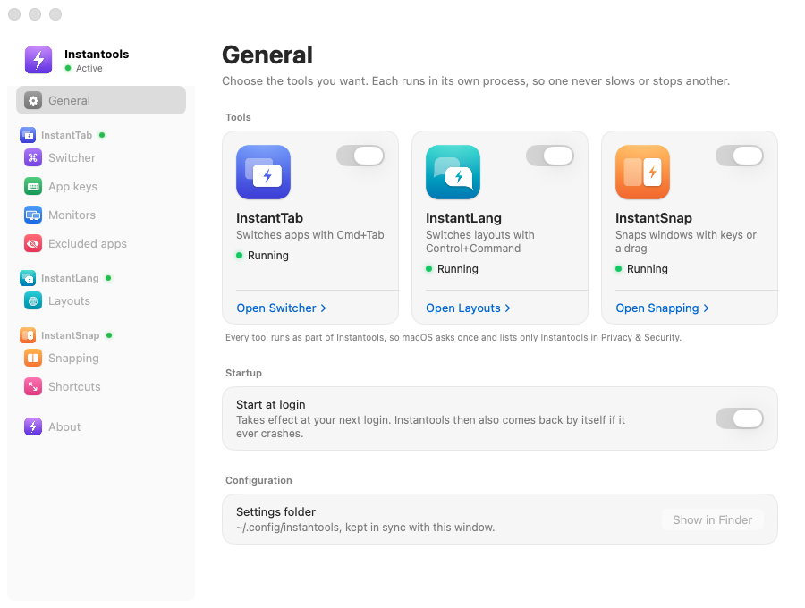
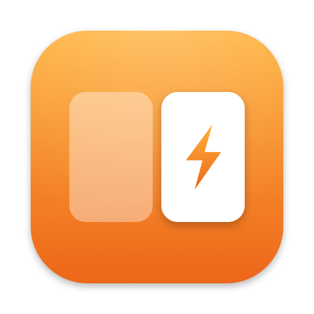
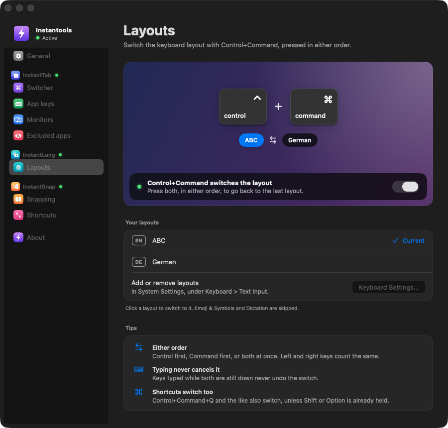
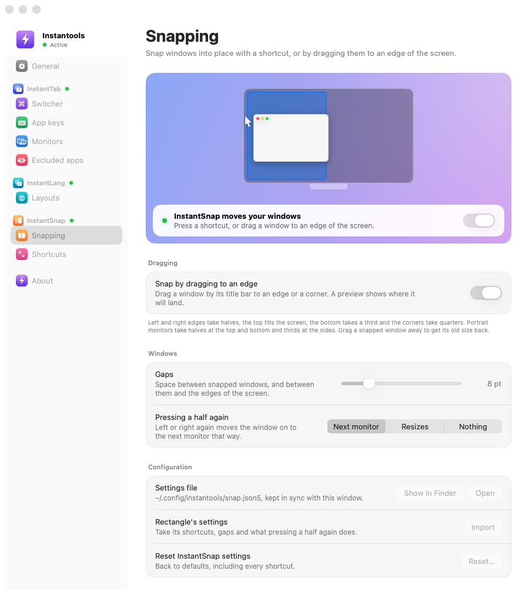

<p align="center">
  
</p>

<h1 align="center">Instantools</h1>

<p align="center">
  Mac tools that respond the moment you press them.
</p>

<p align="center">
  
  
  
  
</p>

<p align="center">
  
</p>

One menu bar app with three tools. Turn on only the ones you want. They share one Settings window, one login item and one set of permissions, and each runs in its own process, so one never slows or stops another.

| | Tool | What it does |
|---|---|---|
|  | **InstantTab** | An app switcher that appears the moment you press Cmd+Tab |
|  | **InstantLang** | Switches the keyboard layout with Control+Command, pressed in either order |
|  | **InstantSnap** | Snaps windows into place with a shortcut, or by dragging them to an edge of the screen |

## InstantTab

An app switcher drawn in time for the next display frame, with the control macOS leaves out.

- **Monitor aware.** List apps from every monitor, the one under the mouse, the one you are working on, or a group such as "external".
- **Straight to an app.** Bind a key to an app, then Cmd+Tab and that key goes right to it, or opens it.
- **Yours to shape.** Exclude apps, let virtual machines keep Cmd+Tab, and pick whether pointing selects an app or only a click does.
- **Safe.** Native Cmd+Tab comes back whenever InstantTab is turned off, quits, hangs or crashes.

In the switcher, Tab, Shift+Tab and the arrows move, Up and Down open App Exposé, Q and H quit or hide, and Esc cancels.

## InstantLang

Switches the keyboard layout the moment Control and Command are both down, in either order, back to the layout you used last. The switch takes a median of 6 ms. It only listens, so the keyboard is untouched if it ever stops. Shortcuts such as Control+Command+Q switch too, unless Shift or Option is already held.

<p align="center">
  
</p>

## InstantSnap

Window snapping that lands the moment you ask, with nothing animating in between.

- **Rectangle's shortcuts.** It also takes over Rectangle's own settings on first launch, if you have any.
- **Drag to an edge** or a corner, and a preview shows where the window will land. Drag it away and it gets its old size back.
- **Pressing a half again** moves the window to the next monitor or cycles its size, as you choose. Gaps are optional.

<p align="center">
  
</p>

Quit Rectangle first, and turn off macOS's own tiling in System Settings > Desktop & Dock. Settings > Snapping reminds you of both.

## Install

```bash
xcode-select --install              # once, unless Xcode or its command line tools are already installed
git clone https://github.com/infeace/Instantools.git && cd Instantools
scripts/create-signing-cert.sh      # once per Mac, so permissions survive rebuilds
scripts/build.sh --install --run    # build, copy to ~/Applications and launch
```

Requires macOS 14 or later and the Xcode 16 command line tools or later. A welcome window walks you through picking tools, allowing permissions and turning on Start at login. Quit any other Cmd+Tab replacement first. A build may ask whether `codesign` may use the signing key; [docs/development.md](docs/development.md#signing-prompts) explains what Always Allow means. Coming from the standalone InstantTab or InstantLang app, Instantools takes over its settings on first launch.

## Permissions and privacy

macOS asks once and lists only Instantools. Accessibility covers every tool; used on its own, InstantLang needs only Input Monitoring.

That is the access a keylogger needs, so Instantools opens no network connections and never stores or logs a key. InstantLang listens only to modifier keys, InstantTab sees other keys only while its switcher is open, and InstantSnap gets only its own shortcuts. Logs hold status only, and [docs/development.md](docs/development.md#privacy-in-the-code) points to the code to check. To report a security problem, see [SECURITY.md](SECURITY.md).

## Configure

Settings and the files in `~/.config/instantools` stay in sync, so edit whichever you prefer: `cmd-tab.json5` for InstantTab and `snap.json5` for InstantSnap. Each file documents every option.

## Uninstall

Turn off Start at login in Settings > General, quit Instantools from the bolt in the menu bar, which brings native Cmd+Tab back, and delete `~/Applications/Instantools.app`. To also remove your settings, its permissions and the signing identity:

```bash
rm -rf ~/.config/instantools
defaults delete com.infeace.Instantools
tccutil reset All com.infeace.Instantools
security delete-identity -t -c "Instantools Local Signing"
```

## Develop

How it works, building, tests, the code layout and the roadmap are in [docs/development.md](docs/development.md).

## License

MIT, see [LICENSE](LICENSE).
